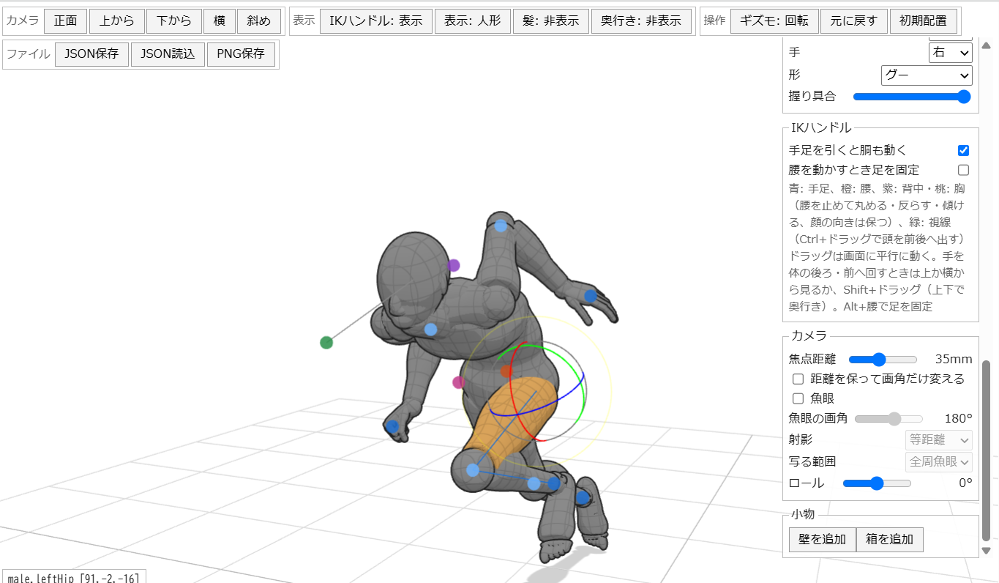

# posing-kun

ブラウザで動く、ポーズ作りの道具です。マネキンの造形で、IK ハンドルとギズモで手で動かします。ControlNetの入力に使ったりできます。

バイブコーディングの実験で作ったものなので特にメンテ予定はありません。



HTML/JSのみで実装されています。three.js の取得だけ CDN（jsdelivr）から行いますが、それ以外の外部通信はありません。

100% AI Coding

## できること

- IK ハンドル: 手足・肘・膝・腰・胸・背中・視線を引いて姿勢を作る
- ギズモ: 部位をクリックして関節を回す（手首・足首は 3 軸、足の指も曲がる）
- 体型（身長・肩幅・腰幅・筋肉・脂肪・胸）と姿勢（胸を開く・背を丸める・すくめる・首を前へ）
- カメラの焦点距離・魚眼・ロール、JSON の保存と読み込み、PNG 保存

## 動かす

ビルドは要りません。`web/` を静的ファイルとして配信して開きます。three.js は jsdelivr の CDN（0.170.0）から読みます。

```sh
cd web && python3 -m http.server 8000
# http://localhost:8000/
```

## エージェントから操作する

ブラウザが WebMCP（`document.modelContext`）に対応していれば、ページを開いた時点で道具が登録されます。対応していないブラウザでも、ページの JavaScript から同じ道具を呼べます。

```js
posingKun.tools                       // 道具の一覧（name, description, inputSchema）
await posingKun.call('get_reference') // 関節の名前・角度の意味・可動域
await posingKun.call('set_joints', { who: 'male', joints: { leftElbow: [90], head: [0, 0, 30] } })
await posingKun.call('reach', { who: 'male', limb: 'rightHand', to: { who: 'female', part: 'leftShoulder' } })
```

道具: `get_scene` `get_reference` `set_joints` `reach` `look_at` `set_pose_preset` `place_doll` `face_toward` `set_hand` `set_body` `set_posture` `set_camera` `show_dolls` `add_prop` `update_prop` `remove_prop` `undo` `reset_scene` `run_ops`。どれも「元に戻す」で戻せます。「編集する人形」の欄は宣言的な道具（`<form toolname="choose_doll_to_edit">`）です。

## ライセンス

MIT
